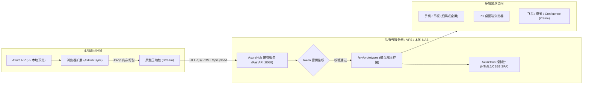

# AxureHub - 全功能轻量级私有化 Axure 原型托管平台与一键同步助手

<p align="center">
  
</p>

<p align="center">
  <strong>专为产品经理、交互设计师与开发团队打造的 100% 自主可控、极速安全的私有化原型托管方案。</strong><br>
  免商业授权锁定 · 一键浏览器秒级同步 · 极简科技双模态控制台 · 手机端流式自适应
</p>

<p align="center">
  
  
  
  
  
</p>

---

## 🌟 项目亮点

- 🚀 **极速轻量后端**：基于 Python FastAPI 构建，内嵌 GZip 高性能流式压缩，内存占用低于 40MB，解压分发秒级完成。
- 🎨 **Qoder 极简科技控制台**：
  - **日光/极夜双模态外观**：内置深色（Dark）与浅色（Light）模式，天体运行级太阳绽放与月亮轨道微动效，全站色彩流体无缝平滑渐变，持久化记忆偏好。
  - **手机端/平板流式自适应**：iPhone 刘海屏/灵动岛浸入，2x2 紧凑指标网格，触控操作防误触网格，移动端 100% 满屏原生应用级原型播放器。
  - **多维原型管理**：实时项目总数、活跃状态、磁盘容量监控，毫秒级关键字搜索，一键生成真机测试二维码与 iframe 网页嵌入代码。
  - **手动包上传**：无需浏览器扩展亦可在控制台直接拖拽/上传 ZIP 原型包，自动解压上线。
- 🧩 **AxHub 原型同步助手 (Chrome/Edge 扩展)**：
  - 遵循 Chrome Manifest V3 最新规范，杜绝第三方商业 SaaS 账号锁与高额坐席费用。
  - 在 Axure RP 按 `F5` 本地预览时，右下角自动唤起沉浸式悬浮胶囊，一键完成本地资源打包、分卷传输、云端解压并自动复制公网预览链接。
- 🔐 **企业级 API 密钥管理池**：
  - 支持多 Token 独立分发与管理（备注名称、掩码安全保护、独立启停开关、一键复制）；
  - 全局支持开启/关闭强制鉴权，自由适配团队内部局域网公开或公网高防严密安全策略。

---

## 📐 系统架构



---

## 🚀 快速开始与部署指南

### 方案 A：Docker Compose 一键部署（强烈推荐）

#### 1. 克隆代码仓库
```bash
git clone https://github.com/saulgoodgirl/axurehub.git
cd axurehub
```

#### 2. 配置环境变量
复制环境配置模版并设置你的主管理员密钥：
```bash
cp .env.example .env
```
编辑 `.env` 文件（或按默认配置启动）：
```ini
PORT=8088
AUTH_TOKEN=your-secure-admin-token-here
PROTOTYPES_DIR=./data/prototypes
TZ=Asia/Shanghai
```

#### 3. 启动容器
```bash
docker compose up -d
```
启动成功后，在浏览器访问：
```text
http://<你的服务器IP或域名>:8088
```

---

### 方案 B：原生 Python 环境部署

适用于没有 Docker 环境的 VPS、云主机或本地开发测试：

#### 1. 环境准备
确保已安装 Python 3.10+，安装核心依赖：
```bash
cd server
pip install -r requirements.txt
```

#### 2. 启动服务
```bash
# Linux / macOS
export AUTH_TOKEN="your-secure-admin-token-here"
export PORT=8088
python app.py

# Windows PowerShell
$env:AUTH_TOKEN="your-secure-admin-token-here"
$env:PORT="8088"
python app.py
```
终端输出 `Uvicorn running on http://0.0.0.0:8088` 即代表服务已就绪。

---

### 方案 C：公网 HTTPS 安全反代（Nginx / Cloudflare）

若部署在公网，建议配置 HTTPS 加密访问以保障原型机密安全。

#### Nginx 反向代理配置示例
```nginx
server {
    listen 80;
    server_name proto.yourdomain.com;
    return 301 https://$host$request_uri;
}

server {
    listen 443 ssl http2;
    server_name proto.yourdomain.com;

    ssl_certificate /etc/nginx/ssl/yourdomain.crt;
    ssl_certificate_key /etc/nginx/ssl/yourdomain.key;

    # 客户端上传原型 ZIP 最大体积限制
    client_max_body_size 200M;

    location / {
        proxy_pass http://127.0.0.1:8088;
        proxy_set_header Host $host;
        proxy_set_header X-Real-IP $remote_addr;
        proxy_set_header X-Forwarded-For $proxy_add_x_forwarded_for;
        proxy_set_header X-Forwarded-Proto $scheme;
    }
}
```

---

## 🧩 浏览器同步扩展安装与配置

### 1. 安装扩展程序（Chrome / Edge）
1. 在浏览器地址栏输入并打开扩展管理页：
   - **Chrome**: `chrome://extensions/`
   - **Edge**: `edge://extensions/`
2. 开启右上角的 **「开发者模式 (Developer Mode)」**。
3. 点击 **「加载已解压的扩展程序 (Load unpacked)」**。
4. 选择本项目根目录（包含 `manifest.json` 的目录）。

### 2. 配置扩展连接
1. 点击浏览器右上角扩展栏中的 **AxureHub 图标**；
2. 填入你的服务配置：
   - **云端接收服务器**：例如 `http://192.168.1.100:8088` 或 `https://proto.yourdomain.com`；
   - **授权凭证 (Token)**：填入服务端配置的 `AUTH_TOKEN`（或在控制台「🔑 端点与密钥」生成的密钥）；
   - **自定义公网域名 (可选)**：若配置了反代域名可在此填写，同步成功后会自动使用该域名生成分享链接；
3. 点击 **「连通性测试」**，验证系统返回绿色通过状态后点击 **「保存配置」**。

### 3. 一键同步推送原型
1. 在 Axure RP 8/9/10 中，点击顶部工具栏 **「预览」** 或直接按快捷键 **`F5`**；
2. 浏览器打开本地原型页面（`127.0.0.1:32767/start.html`）后，右下角将自动浮现 **AxureHub 同步悬浮胶囊**；
3. 点击 **「一键同步至云端」**，插件将在数秒内将整个原型打包解压上线，并自动将访问链接复制至剪贴板！

---

## 💻 Web 控制台功能指引

打开控制台网页即可进入完整的原型资产托管后台：

| 功能模块 | 说明 |
| :--- | :--- |
| **原型托管列表** | 支持卡片视图与列表视图切换，展示项目名称、文件数、体积大小、最后更新时间 |
| **在线交互预览** | 点击「预览」调起桌面全屏播放器或手机端沉浸式体验，支持全屏展开与直接在新标签页打开 |
| **二维码移动端真机体验** | 点击「分享」即时生成高保真矢量二维码，手机扫码即可直接测试移动端 Axure 原型 |
| **iframe 嵌入支持** | 一键复制 `<iframe>` 网页嵌入代码，完美嵌入飞书文档、语雀、Confluence、Notion 等知识库 |
| **容量管理与清空** | 提供软清空（释放 HTML/切图静态存储，保留历史条目）与硬删除（彻底清理物理文件）双重选项 |
| **端点与密钥管理** | 支持动态签发多枚不同备注的 API Key，提供启停滑块、明文切换与全局强制鉴权开关 |
| **主题切换** | 顶部右上角一键切换暗夜/白天主题，支持天体物理动效并持久化保持偏好设置 |

---

## ⚙️ 环境变量清单

| 变量名 | 默认值 | 说明 |
| :--- | :--- | :--- |
| `PORT` | `8088` | 服务监听端口 |
| `AUTH_TOKEN` | `admin-token-secret` | 默认主系统密钥（可作为管理员凭据访问管理 API） |
| `PROTOTYPES_DIR` | `/srv/prototypes` | 原型文件与 tokens.json 物理存储路径 |
| `TZ` | `Asia/Shanghai` | 容器运行时区设置 |

---

## 🔒 安全与生产建议

1. **修改默认密钥**：首次部署上线时，务必将 `.env` 中的 `AUTH_TOKEN` 修改为高强度的复杂随机字符串。
2. **生产强制鉴权**：建议在 Web 控制台的「🔑 端点与密钥」面板中保持开启「强制验证 API 密钥」。
3. **团队分权分发**：为不同业务线、项目组或设计师在后台单独生成独立的 Token，当人员变动时只需在后台一键禁用对应 Key，无需重置服务器。

---

## 📄 开源许可证

本项目采用 [MIT License](LICENSE) 开源许可证。欢迎提交 Issue、PR 共同完善！
